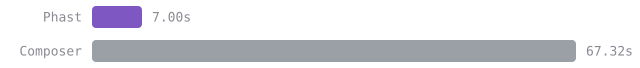
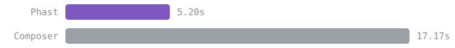
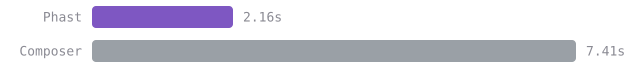
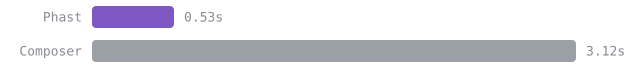

Phast is an extremely fast dependency manager for PHP, written in Rust. It is a drop-in
alternative to Composer: it resolves, downloads, and autoloads your dependencies from
Packagist and any Composer-compatible registry, while introducing a clean TOML-first
workflow built around `phast.toml` and `phast.lock`.

## Highlights

- **Fast.** Downloads and extraction run fully in parallel, so cold installs are quick and
  repeat installs are nearly instant.
- **Resolution in a blink.** A conflict-driven resolver makes short work of huge dependency
  graphs: real-world projects of 150+ packages resolve in well under a second.
- **Composer-compatible.** Works with Packagist, Private Packagist, and Satis. Generates
  a `vendor/autoload.php` your application uses exactly as before, including the
  `\Composer\InstalledVersions` runtime API.
- **One command to migrate.** `phast migrate` converts an existing `composer.json` into
  `phast.toml`; run `phast install` and you are done.
- **First-class monorepos.** Workspaces with shared dependency constraints, a single
  lock file, and a single `vendor/` directory. No path-repository wiring.
- **Built-in security tooling.** `phast audit` checks your lock file against security
  advisories, and `minimum-package-age` shields you from freshly published supply-chain
  attacks.

## How fast?

Installing [koel](https://github.com/koel/koel) v9.15.0, a real application with 202
packages, one of them installed straight from a Git repository. Median of 5 runs on one
machine.

**Cold start**, first ever install: no lock file, empty cache:

**From a lock file**, like a fresh CI runner: lock committed, empty cache:

**Warm cache**, like CI with a restored cache or a second local project:

**Nothing to do**, running install again in a project that is already installed:

How much faster, for koel and for the Laravel skeleton (109 packages). A cold start gains
the most on a large project, where Composer spends the longest resolving and fetching:

| Scenario         | koel | Laravel skeleton |
|------------------|-----:|-----------------:|
| Cold start       | 9.6x |             2.4x |
| From a lock file | 3.3x |             3.0x |
| Warm cache       | 3.4x |             5.7x |
| Nothing to do    | 5.9x |             6.7x |

Composer 2.8.10 and PHP 8.4 on an Apple M3 Pro over a fast connection, both tools with
scripts disabled and isolated caches, Composer with its optimized autoloader. koel ran
without `roave/security-advisories`, whose conflict rules change daily. The benchmark is
`make test-bench` in the repository, and the run behind these numbers is
[published there](https://github.com/phast-sh/phast/tree/main/testing/perf/results/2026-10-14-1003).

## Where to start

- [Installation](getting-started/installation.md)
- [First steps](getting-started/first-steps.md)
- [Migrating from Composer](guides/migrate-from-composer.md)
